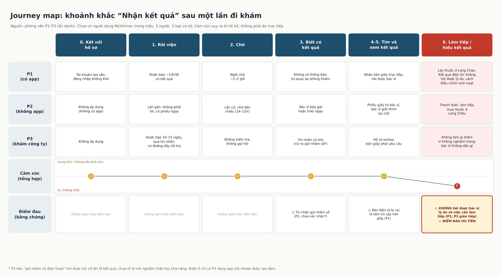

# Journey map – khoảnh khắc: Nhận kết quả

> Dựng từ phỏng vấn P1–P3 ([tổng hợp](../01-phong-van/tong-hop-insight.md)) trên khung [luong-nhan-ket-qua.md](../01-phong-van/luong-nhan-ket-qua.md). **Bản nháp do Claude dựng, Linh kiểm lại.** Cảm xúc được suy ra từ lời kể (không ai bộc lộ trực tiếp ngoài P1 ở bước 6). Chưa có người dùng MyVinmec trong mẫu và chưa dùng thử app, nên các bước 2–5 trên MyVinmec chưa được kiểm chứng.

Ký hiệu cảm xúc: 😐 trung tính / không nêu khó chịu; 😟 lo / không chắc.

| Bước | Người bệnh làm gì | Kênh / điểm chạm | Thời gian | Cảm xúc | Điểm đau (⚠) | Bằng chứng |
|---|---|---|---|---|---|---|
| 0 (ẩn). Kết nối hồ sơ | P1: dùng tài khoản được tạo sẵn, đăng nhập | App | — | 😐 | Không nghe thấy | P1 "Họ đã đăng ký sẵn cho tao" |
| 1. Rời viện | Được báo giờ / thời hạn có kết quả | Nhân viên, bác sĩ, tin nhắn | — | 😐 | Không nghe thấy | P1 (13h30), P2 (14–15h, lần cũ), P3 (10–15 ngày) |
| 2. Chờ | P1 ngồi chờ; P2 lần cũ chờ đến chiều; P3 không làm gì | Tại viện / không | P1 ~1–2 giờ; P2 nửa ngày (lần cũ); P3 10–15 ngày | 😐 | Không nghe thấy | P1, P2, P3: không ai gọi hỏi |
| 3. Biết có kết quả | P1 tự quay lại; P2 bác sĩ trao ngay; P3 nhận tin nhắn có link | Phòng khám / tin nhắn | — | 😐 | ⚠ Tin nhắn có thể gửi nhầm số *(P3, chưa xác nhận)* | P1 "không có thông báo gì hết"; P3 |
| 4. Tìm kết quả | P1 đăng nhập app (các lần trước); P3 mở link | App / tin nhắn | — | 😐 | Không nghe thấy | P1 "không bị nhầm"; P3 |
| 5. Xem kết quả | Nhận giấy trực tiếp (P1, P2) hoặc hồ sơ online (P3) | Giấy / online | — | 😐 | ⚠ Bản điện tử bị coi kém tin cậy hơn giấy *(P1, nhận định chung)* | P1 "tao vẫn thích nhận kết quả trực tiếp hơn" |
| 6. Làm tiếp | Mua thuốc ở nhà thuốc ngoài (P1, P2); P3 không làm gì thêm | Nhà thuốc / không | — | P1: 😟; P2, P3: 😐 | ⚠ **Không hỏi được bác sĩ lý do và việc cần làm tiếp khi nhận kết quả từ xa** | P1 (rõ), P3 (gián tiếp); P2 là đối chứng |
| X. Nhánh lỗi | Chưa nghe ai gặp lỗi lấy kết quả; P3 có đường dây hỗ trợ nhưng chưa dùng | Hotline | — | — | Chưa có dữ liệu | P3 |

## Khoảng trống đã thấy từ tài liệu: kiểm tra bằng phỏng vấn
- Bước 2 (chờ): giả thuyết "người bệnh không biết kết quả đã có chưa" **không được ủng hộ**: cả 3 đều được báo giờ trước và không ai phải hỏi.
- Bước 0 (OTP): chưa kiểm chứng; P1 có tài khoản tạo sẵn.
- Bước 6 (làm tiếp): có tín hiệu từ P1 và P3.

## Điểm đau được đánh dấu
1. ⚠ Nhận kết quả từ xa mà không hỏi được bác sĩ lý do và việc cần làm tiếp (P1, P3 gián tiếp).
2. ⚠ Bản điện tử bị coi kém tin cậy hơn bản giấy (P1).
3. ⚠ Tin nhắn gửi nhầm số (P3, chưa xác nhận).

## Điểm đau ưu tiên đi tiếp
- Điểm 1, vì là điểm duy nhất có người nói thẳng và có đối chiếu (P2 được bác sĩ giải thích tại chỗ nên không gặp). Cần thêm ít nhất 1–2 cuộc phỏng vấn người nhận kết quả qua app để vững hơn.
