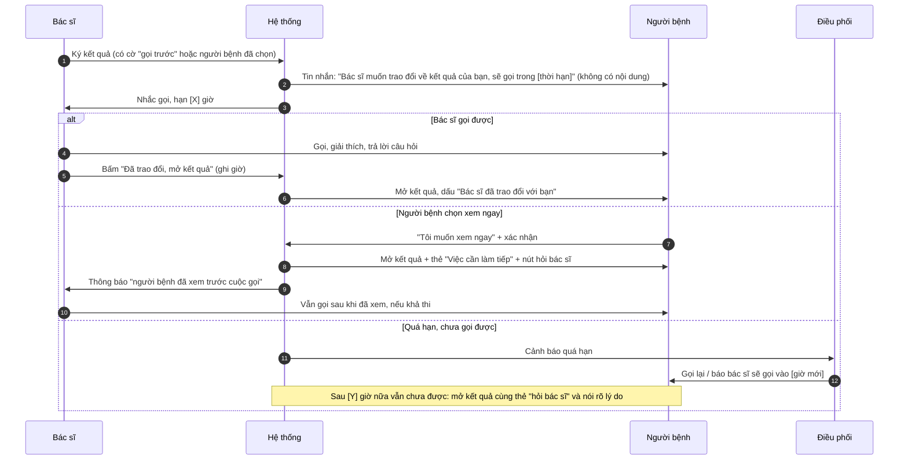

# Luồng hoạt động: "Bác sĩ gọi trước khi xem kết quả"

> Bản nháp do Claude lập ngày 20/10/2026 theo yêu cầu của Linh. **Chỉ là luồng, chưa đưa vào v2.** Căn cứ: [deep research BP1](../04-best-practice/deep-research/bao-cao-deep-research.md) (số liệu chưa mở lại nguồn gốc) và phỏng vấn P1–P3. Mọi điểm đánh dấu **[cần xác nhận]** là giả định, cần bác sĩ / Vinmec xác nhận.

## 1. Vấn đề và căn cứ
- Ở Mỹ, người bệnh thường thấy kết quả cùng lúc bác sĩ; chỉ 28% được hỏi có muốn xem trước hay không; người xem kết quả bất thường lo hơn rõ rệt (16,5% so với 5,0% với kết quả bình thường). Một số bang Mỹ buộc trì hoãn kết quả ung thư / di truyền (Texas: 72 giờ). *(Theo deep research, chưa kiểm lại nguồn.)*
- P1 tin kết quả nhận trực tiếp từ bác sĩ hơn bản điện tử vì hỏi được ngay. Nhưng P1 là một người, nhận định chung; **chưa có dữ liệu người Việt về việc có muốn tùy chọn này không**.
- Ý tưởng: với một số kết quả, người bệnh **được bác sĩ gọi giải thích trước**, rồi mới xem; người bệnh vẫn có quyền xem ngay.

## 2. Nguyên tắc
1. **Bác sĩ quyết định loại kết quả nào cần gọi trước, không phải AI.** AI không phân loại mức độ nghiêm trọng.
2. **Người bệnh luôn có quyền xem ngay**, sau một bước xác nhận có thông tin rõ ràng; không giữ kết quả của người bệnh mà không có lối ra.
3. Có **thời hạn** cho cuộc gọi; quá hạn thì chuyển người điều phối và thông báo người bệnh, không để kết quả "treo".
4. Tin nhắn không chứa nội dung kết quả (như v1).
5. Cuộc gọi là trao đổi y khoa của bác sĩ; hệ thống chỉ hỗ trợ đặt lịch gọi và ghi nhận.

## 3. Các bên
| Bên | Vai trò |
|---|---|
| Người bệnh | Chọn ưu tiên; nhận cuộc gọi; xem kết quả |
| Bác sĩ chỉ định | Gắn cờ "cần trao đổi trước" cho kết quả; gọi; mở kết quả |
| Điều phối / tổng đài | Nhận cảnh báo khi quá hạn; gọi lại; xử lý không liên lạc được **[cần xác nhận cơ cấu]** |
| Hệ thống | Giữ / mở kết quả theo trạng thái, nhắc, ghi giờ |

## 4. Hai nguồn kích hoạt
1. **Cờ của bác sĩ** (chính): khi ký kết quả, bác sĩ chọn "Gọi người bệnh trước khi mở kết quả" (mặc định bật cho nhóm kết quả mà khoa đã quy định, **[cần xác nhận danh mục]** ví dụ giải phẫu bệnh, kết quả nghi nghiêm trọng).
2. **Lựa chọn của người bệnh** (phụ): lúc đăng ký khám hoặc trong ứng dụng, người bệnh chọn "Tôi muốn bác sĩ gọi trước khi xem kết quả" cho lần khám này. **[cần xác nhận]** có cho người bệnh chọn cho mọi kết quả hay chỉ một số nhóm.

Nếu một trong hai nguồn bật thì áp dụng luồng "gọi trước". Nếu không, kết quả mở bình thường như v1.

## 5. Luồng chính

## 6. Trạng thái của kết quả
| Trạng thái | Người bệnh thấy | Chuyển sang | Điều kiện |
|---|---|---|---|
| Đang chờ ký | (chưa có gì) | Chờ gọi hoặc Đã mở | Bác sĩ ký |
| Chờ cuộc gọi | Tin nhắn + màn hình "Bác sĩ sẽ gọi bạn trong [giờ]" kèm nút "Xem ngay" | Đã trao đổi / Đã mở (xem ngay) / Quá hạn | Có cờ |
| Quá hạn | Màn hình "Bác sĩ chưa gọi được, đã báo điều phối" + "Xem ngay" | Đã trao đổi / Đã mở | Hết thời hạn |
| Đã trao đổi | Kết quả + dấu "Bác sĩ đã trao đổi" | (cuối) | Bác sĩ bấm mở |
| Đã mở (xem ngay) | Kết quả + thẻ hỗ trợ | (cuối) | Người bệnh xác nhận |

## 7. Màn hình người bệnh (khi đưa vào prototype sau này)
1. **Tin nhắn:** "Kết quả đã sẵn sàng. Bác sĩ muốn trao đổi với bạn trước. Mở ứng dụng để biết thêm." (không nội dung).
2. **Màn "Bác sĩ sẽ gọi bạn":** giờ dự kiến; số điện thoại sẽ gọi (người bệnh kiểm tra và sửa nếu sai); nút **"Xem kết quả ngay"**; nút "Đổi giờ gọi"; dải 115.
3. **Xác nhận xem ngay:** "Kết quả có thể gây lo lắng nếu xem khi chưa trao đổi với bác sĩ. Bạn vẫn có thể xem ngay, và bác sĩ vẫn sẽ gọi bạn." → [Xem ngay] [Chờ bác sĩ gọi].
4. **Sau khi mở:** thẻ "Việc cần làm tiếp" và "Hỏi bác sĩ" như v1.

## 8. Tình huống đặc biệt
| Tình huống | Xử lý đề xuất |
|---|---|
| Không bắt máy | Gọi lại theo lịch (ví dụ 3 lần trong thời hạn); để lại tin nhắn không có nội dung kết quả; quá hạn → điều phối |
| Số điện thoại sai / gửi nhầm (P3 nêu rủi ro này) | Tin nhắn không nội dung; xác minh danh tính trước khi nói nội dung (hỏi thông tin đã đăng ký); không đọc kết quả khi chưa xác minh |
| Người nghe máy không phải người bệnh | Không trao đổi nội dung; hẹn lại |
| Người bệnh muốn xem ngay nhưng bác sĩ muốn trì hoãn | Người bệnh vẫn được xem sau xác nhận **[cần xác nhận chính sách; ngoại lệ pháp lý nếu có]** |
| Dấu hiệu khẩn cấp lúc gọi | Quy trình khẩn cấp của bác sĩ / cơ sở, không đi qua hệ thống này |
| Kết quả bình thường | Không bật luồng (trừ khi người bệnh tự chọn) |
| Bác sĩ nghỉ / đổi ca | Chuyển cho bác sĩ trực hoặc điều phối khi quá hạn |

## 9. Vai trò của AI (nếu có)
- **Không** quyết định giữ / mở kết quả; **không** phân loại mức độ.
- Có thể: soạn tin nhắn nhắc không có nội dung kết quả; tóm tắt cho bác sĩ "người bệnh đã hỏi gì trong lúc chờ"; soạn nháp ghi chú sau cuộc gọi cho bác sĩ duyệt. Mọi thứ bác sĩ duyệt như v1/v2.

## 10. Đo
- Thời gian từ ký đến cuộc gọi (trung vị, tỷ lệ quá hạn).
- Tỷ lệ chọn "Xem ngay" trước cuộc gọi.
- Mức hiểu tự đánh giá sau khi xem (1–5) giữa hai nhóm: được gọi trước và xem ngay.
- Mức lo lắng tự đánh giá khi chờ (1–5) và có chấp nhận khoảng chờ không.
- Số cuộc gọi và thời gian bác sĩ bỏ ra (chi phí vận hành).

## 11. Rủi ro riêng
| Rủi ro | Giảm thiểu |
|---|---|
| Người bệnh lo lắng hơn khi biết "có chuyện" (chỉ tin nhắn "bác sĩ muốn trao đổi") | Thời hạn ngắn; nói rõ đây là quy trình thường quy cho một số nhóm kết quả; có nút xem ngay |
| Kết quả bị giữ lâu, bác sĩ quá tải | Thời hạn, cảnh báo quá hạn, tự mở sau [Y] giờ kèm thẻ hỏi bác sĩ |
| Người bệnh tìm thông tin trên mạng khi chờ (56,7% tìm thêm trong khảo sát Mỹ) | Rút ngắn thời hạn; không có kênh nào khác thay thế |
| Lộ thông tin qua cuộc gọi hoặc tin nhắn | Xác minh danh tính; không nội dung trong tin nhắn |
| Phụ thuộc pháp lý: quyền tiếp cận hồ sơ của người bệnh | **[cần xác nhận với pháp chế Vinmec]** có được giữ kết quả điện tử và trong bao lâu |

## 12. Câu hỏi mở (cần trả lời trước khi đưa vào prototype)
1. Danh mục kết quả nào bác sĩ muốn gọi trước? Ai quyết định?
2. Thời hạn cuộc gọi hợp lý và khả thi (trong giờ làm việc)? Ai gọi khi bác sĩ bận?
3. Người bệnh có được giữ quyền xem ngay, và cơ sở có chấp nhận điều đó?
4. Người Việt có muốn tùy chọn này không? Cần phỏng vấn thêm 3–5 người (nhóm đã từng nhận kết quả nặng hoặc có người thân nhận) với câu hỏi theo "lần gần nhất", không hỏi nội dung bệnh.
5. Thông tư 13/2025/TT-BYT và Luật 91/2025/QH15 có ràng buộc gì về thời điểm và cách cung cấp kết quả cho người bệnh? *(Hiện chỉ dựa trên nguồn thứ cấp.)*

## 13. Khi nào nên đưa vào prototype
Chỉ khi (a) trả lời được câu 1–3, và (b) có tín hiệu từ phỏng vấn thêm rằng người dùng muốn tùy chọn này. Khi đó thêm 2 màn hình (mục 7) vào prototype và đo mục 10 với 3–5 người thử.
